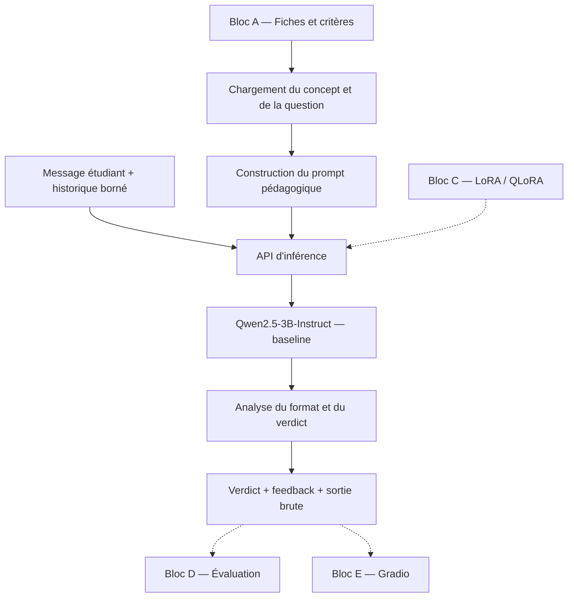

# Brainmaxxing

**Agent conversationnel d'apprentissage actif — Mini-projet NLP & Transformers**

Brainmaxxing est un projet de tuteur pédagogique fondé sur un modèle de langage. Son objectif est d'aider un étudiant à **comprendre un concept, formuler un raisonnement avec ses propres mots et recevoir un retour ciblé** plutôt que de lui fournir directement une correction.

Le projet est développé dans le cadre du **Mini-projet 2 — Agent conversationnel : du Transformer pré-entraîné à une application de dialogue**. Il suit une démarche expérimentale : observer un Transformer instructionnel, construire une baseline sans entraînement, préparer des dialogues, adapter le modèle avec LoRA/QLoRA, puis comparer les deux versions dans une interface Gradio.

> **État de `main` au 21 octobre 2026** — Fiches pédagogiques, dataset (1 003 exemples), baseline, adaptateur QLoRA v1.1, entraînement et évaluation comparative enregistrée sont intégrés. La correction du parcours Gradio est proposée dans [PR #12](https://github.com/EmineOA/NLP-Transformers/pull/12) ; la PR #11 reste ouverte. Le notebook final `agent.ipynb`, le rapport et les validations humaines sont à finaliser.

## Fonctionnement pédagogique

Le parcours visé est le suivant :

1. **Découvrir un concept** : l'étudiant consulte le contenu pédagogique organisé en sections.
2. **Répondre à une question ouverte** : il explique, justifie ou applique ce qu'il a compris.
3. **Recevoir une évaluation** : le modèle s'appuie sur les critères propres à la question pour attribuer un verdict et formuler un feedback.
4. **Approfondir son raisonnement** : en cas de réponse incomplète ou incorrecte, l'étudiant reçoit des indices et peut réessayer.
5. **Progresser** : le parcours prévu comporte au maximum trois essais par question, puis passe à la suivante selon les règles de l'application.

Les verdicts pédagogiques sont :

| Verdict | Signification |
|---|---|
| `PARFAIT` | Les critères de compréhension attendus pour la question sont satisfaits. |
| `PARTIEL` | Le raisonnement comporte des éléments pertinents, mais reste incomplet ou imprécis au regard de la grille. |
| `INCORRECT` | La réponse comporte une erreur majeure ou ne répond pas aux attentes de la question. |
| Refus / redirection | L'étudiant demande une solution toute faite, tente de manipuler l'évaluation ou formule une demande non autorisée. |

Une réponse simplement hors sujet est classée `INCORRECT` selon les fiches actuelles ; elle n'est pas automatiquement considérée comme un refus. Le comportement doit rester limité au corpus pédagogique disponible.

### Périmètre

- **MVP académique** : un agent spécialisé, des fiches contrôlées, une baseline, une adaptation LoRA/QLoRA, une évaluation avant/après et une interface Gradio lancée depuis un notebook.
- **Évolutions envisagées** : nouveaux domaines, ressources documentaires via RAG, suivi de progression, gamification et application web/mobile. Ces évolutions ne font pas partie des fonctionnalités actuellement livrées sur `main`.

## Corpus pédagogique

Le corpus disponible comporte **6 concepts répartis en 2 matières, pour 17 questions ouvertes**.

| Matière | Concepts | Questions |
|---|---|---:|
| Mathématiques | [Monty Hall](data/concepts/json/monty-hall.json), [les infinis](data/concepts/json/infinis-plus-grands-que-l-infini.json), [croissance exponentielle](data/concepts/json/plier-une-feuille-42-fois.json) | 8 |
| Philosophie | [bateau de Thésée](data/concepts/json/bateau-de-thesee.json), [dilemme du tramway](data/concepts/json/dilemme-du-tramway.json), [doute de Descartes](data/concepts/json/doute-de-descartes.json) | 9 |

Les fiches existent dans deux formats :

- [`data/concepts/markdown/`](data/concepts/markdown/) : **sources éditoriales** contenant les contenus pédagogiques.
- [`data/concepts/json/`](data/concepts/json/) : **fiches structurées générées**, utilisées par le moteur. Elles ne doivent pas être modifiées manuellement.

Chaque question définit notamment un `enonce`, des `points_cles`, deux `indices`, des `niveaux` d'évaluation (`parfait`, `partiel`, `incorrect`, `refus`) et un emplacement `apres_section` dans la progression du cours. Les critères de `niveaux` priment sur une simple comparaison de mots-clés. Par exemple, les questions philosophiques évaluent la cohérence d'une justification, et non l'adhésion à une seule opinion.

Le format détaillé est décrit dans [`data/concepts/json/AGENTS.md`](data/concepts/json/AGENTS.md).

## Architecture



L'API commune `generate_response(...)` permet de séparer le moteur d'inférence des consommateurs : évaluation, application et, ultérieurement, modèle adapté. Le moteur ne décide pas à lui seul du changement de question ni du compteur d'essais.

### Répartition fonctionnelle

| Bloc | Responsabilité | Epic(s) |
|---|---|---|
| **A — Pédagogie** | Rôle de l'agent, fiches, questions, critères de réussite et règles de refus | E1 |
| **B — Moteur LLM** | Observation du Transformer, génération, prompts, historique, baseline et interface d'inférence | E2–E3 |
| **C — Données et adaptation** | Dialogues supervisés, séparation des données, entraînement LoRA/QLoRA et sauvegarde de l'adaptateur | E4–E5 |
| **D — Évaluation** | Scénarios de test, métriques, grille humaine et comparaison baseline/LoRA | E6 |
| **E — Application** | Interface Gradio et parcours de l'étudiant | E7 |
| **F — Rendu** | Notebook final, reproductibilité, rapport et livrables | E8 |

Les contrats échangés entre ces blocs sont documentés dans [`backlog.md`](backlog.md#contrats-communs).

## Organisation du dépôt

```text
.
├── data/
│   └── concepts/
│       ├── markdown/                 # Fiches pédagogiques sources
│       └── json/                     # Fiches structurées pour l'agent
├── src/
│   ├── agents/
│   │   ├── concepts.py               # Lecture et validation des fiches
│   │   ├── baseline.py               # Agent et analyse des verdicts
│   │   ├── history.py                # Historique conversationnel
│   │   └── inference.py              # Point d'entrée commun
│   └── llm/
│       ├── model.py                  # Chargement du modèle et du tokenizer
│       ├── decoding.py               # Argmax, température, top-k et top-p
│       ├── generation.py             # Génération conversationnelle
│       └── prompts.py                # Prompts criteria / fewshot
├── experiments/
│   ├── bloc_b_academique.ipynb       # Observation et baseline
│   ├── tokens_logits.ipynb           # Tokens, logits et softmax
│   ├── decoding.ipynb                # Stratégies de génération
│   ├── dev_cases_bloc_b.jsonl        # Cas de développement
│   └── results/                     # Résultats de comparaison des prompts
├── scripts/
│   ├── test_integrated_smoke.py      # Essais réels sur Qwen
│   ├── compare_prompts.py            # Comparaison de configurations
│   └── run_evaluation_v01.py        # Pont vers le bloc D, après intégration
├── tests/                            # Tests des composants A/B
├── archive/explorations/             # Premières expériences conservées
├── README_BLOC_B.md                  # Documentation détaillée du moteur
├── backlog.md                       # Epics, user stories et sprints
└── AGENTS.md                        # Conventions de développement
```

Les dossiers d'entraînement, d'évaluation complète et d'interface seront intégrés au fur et à mesure des travaux des autres blocs. La structure ci-dessus correspond aux éléments déjà présents sur `main`.

## Installation et exécution de la baseline

### Prérequis

- **Python 3.12** : version utilisée lors des validations du bloc B.
- `torch`, `transformers`, `accelerate` et `safetensors` pour l'inférence ; `pandas` et Jupyter pour les expériences.
- Une connexion Internet au premier chargement du modèle depuis Hugging Face.
- Un GPU compatible CUDA est conseillé pour `Qwen/Qwen2.5-3B-Instruct`. Un mode CPU existe dans le code, mais peut être beaucoup plus lent. La configuration CUDA de PyTorch doit correspondre à l'environnement local.

### Mise en place

```bash
git clone https://github.com/EmineOA/NLP-Transformers.git
cd NLP-Transformers
python -m venv .venv
```

Activation de l'environnement :

```powershell
# Windows / PowerShell
.\.venv\Scripts\Activate.ps1
```

```bash
# Linux / macOS
source .venv/bin/activate
```

Installation des dépendances principales de la baseline :

```bash
python -m pip install --upgrade pip
python -m pip install torch transformers accelerate safetensors pandas jupyter
```

**Reproductibilité :** le dépôt ne comporte pas encore de fichier de dépendances entièrement verrouillé. Pour reproduire les mesures sur une autre machine ou sur Colab, conserver les versions exactes des bibliothèques, du modèle, des prompts et du commit utilisé. Pour une installation GPU spécifique, se référer à la procédure d'installation de PyTorch adaptée au système.

### Exécuter les tests

Depuis la **racine du dépôt** :

```bash
# Vérifications techniques et validation des 6 fiches / 17 questions
python -m unittest discover -s tests -p "test_*.py" -v

# Test de bout en bout avec Qwen (télécharge/charge le modèle)
python scripts/test_integrated_smoke.py
```

### Utiliser le moteur depuis Python

```python
from src.agents.concepts import load_concept, load_question
from src.agents.inference import generate_response

concept = load_concept("monty-hall")
question = load_question(concept, "monty-hall_q1")

resultat = generate_response(
    messages=[{
        "role": "user",
        "content": "Je garde, car il reste deux portes, donc 50/50."
    }],
    concept=concept,
    question=question,
    model_version="baseline",
    prompt_version="fewshot",
)

print(resultat["verdict"])
print(resultat["feedback"])
```

Le résultat contient `verdict`, `feedback`, `raw_response` et `valid_format`. Les verdicts autorisés sont `PARFAIT`, `PARTIEL`, `INCORRECT` ou `None` pour un refus ou une sortie invalide ; `valid_format` permet de distinguer les deux derniers cas. Le refus utilise actuellement le marqueur brut `[HORS_PERIMETRE]`, **convention encore à confirmer collectivement**.

Un verdict de Qwen reste une **prédiction** : le moteur peut se tromper même lorsque le format est correct.

### Utiliser l'adaptateur QLoRA (bloc C)

L'adaptateur final est publié en accès public sur Hugging Face : [MonsieurNikko/brainmaxing-qlora-v1.1](https://huggingface.co/MonsieurNikko/brainmaxing-qlora-v1.1). Il s'ajoute à `Qwen/Qwen2.5-3B-Instruct` chargé en 4 bits, ce qui demande un GPU CUDA ainsi que les dépendances de [`requirements-qlora.txt`](requirements-qlora.txt) (sur Colab : `pip install -r requirements-qlora.txt`).

```python
from huggingface_hub import snapshot_download

# dossier attendu par generate_response (LORA_ADAPTER_DIR dans src/agents/inference.py)
snapshot_download("MonsieurNikko/brainmaxing-qlora-v1.1", local_dir="adapters/v1.1/best")
```

Il suffit ensuite de passer `model_version="lora"` à `generate_response` : le prompt, l'historique et le format de sortie sont les mêmes que pour la baseline. Le message de l'étudiant suit, à l'entraînement, le format `RÉPONSE ACTUELLE À ÉVALUER :\n<réponse>`.

L'entraînement, les réglages et les résultats sont présentés dans [`experiments/bloc_c_qlora.ipynb`](experiments/bloc_c_qlora.ipynb) (à lire avec ses sorties) et résumés dans [`experiments/bilan_bloc_c.md`](experiments/bilan_bloc_c.md).

## Expériences et résultats

Les notebooks de [`experiments/`](experiments/) couvrent les notions du cours : identifiants de tokens, logits, softmax, génération autorégressive, argmax, température, top-k, top-p, embeddings, attention causale et unembedding.

La baseline utilise `Qwen/Qwen2.5-3B-Instruct` sans fine-tuning, avec le chat template du tokenizer et une génération déterministe (`do_sample=False`) pour les comparaisons. Deux stratégies de prompting sont étudiées :

- `criteria` : grille d'évaluation et consignes pédagogiques ;
- `fewshot` : même grille, complétée par les exemples étalons des fiches.

Pour rejouer la comparaison :

```bash
python scripts/compare_prompts.py
```

Les résultats détaillés sont enregistrés dans [`experiments/results/`](experiments/results/) :

| Configuration | Verdicts et formats corrects | Formats valides | Cas de développement |
|---|---:|---:|---:|
| `criteria` | 4/9 (44,44 %) | 8/9 (88,89 %) | 9 |
| `fewshot` | 6/9 (66,67 %) | 8/9 (88,89 %) | 9 |

Ces chiffres proviennent d'un **petit jeu de développement**, dont les annotations doivent être revues avec le bloc A. Ils ne mesurent ni les performances finales de l'agent ni l'effet de LoRA. Les réponses de la configuration sélectionnée sont conservées dans [`baseline_reference_dev.jsonl`](experiments/results/baseline_reference_dev.jsonl).

## État des travaux et prochaines intégrations

| Composant | État sur `main` |
|---|---|
| Fiches et grilles pédagogiques (bloc A) | **Disponibles** : 6 concepts, 17 questions |
| Observation du Transformer (bloc B) | **Disponible** : notebooks et implémentations de décodage |
| Baseline pédagogique (bloc B) | **Disponible** : génération, prompts, parsing, historique et tests |
| Dataset supervisé complet (bloc C) | **Intégré** : 1 003 exemples, split 649/177/177 par question entière ; audit humain final non encore démontré |
| Entraînement et adaptateur LoRA/QLoRA (bloc C) | **Intégrés** (PR #10) : run v1.1, courbes train/val, [adaptateur public](https://huggingface.co/MonsieurNikko/brainmaxing-qlora-v1.1) |
| Banc d'évaluation commun (bloc D) | **Intégré** : 20 requêtes, 17 scénarios, scores baseline/LoRA ; notes qualitatives LoRA à valider humainement |
| Interface Gradio / parcours complet (bloc E) | [PR #11](https://github.com/EmineOA/NLP-Transformers/pull/11) ouverte ; corrections A/B/C/E proposées en [PR #12](https://github.com/EmineOA/NLP-Transformers/pull/12) |
| Notebook final `agent.ipynb` et rapport (bloc F) | **À assembler** ; l'adaptateur est disponible séparément via Hugging Face |

Le projet est organisé en **trois sprints** : MVP de bout en bout, passage à l'échelle (corpus et entraînement), puis évaluation et finalisation. Le détail des user stories, dépendances, critères d'acceptation et livrables figure dans [`backlog.md`](backlog.md).

### Critères attendus pour la version académique complète

Conformément au sujet, la livraison finale devra inclure :

- Un jeu de dialogues contrôlé, avec séparation **entraînement / validation / test** et vérification de la qualité ainsi que de l'absence de données personnelles sensibles.
- Une adaptation **LoRA ou QLoRA** du modèle gelé : hyperparamètres documentés, pertes train/validation et meilleur adaptateur sauvegardé selon la validation.
- Une évaluation comparative baseline/LoRA sur **au moins 20 requêtes indépendantes** du jeu d'entraînement, couvrant cinq critères et au moins cinq analyses de réussites ou d'erreurs.
- Une interface **Gradio** avec chat, saisie, réinitialisation et description du rôle et des limites, lancée depuis le notebook.
- Les livrables académiques `agent.ipynb` **exécuté**, `rapport.pdf` (4 pages maximum hors annexes), données ou script reproductible, adaptateur ou lien stable et `README.txt` pour l'exécution.

## Conventions et limites

Le code du moteur peut utiliser les fiches pour évaluer un raisonnement, mais **ne garantit pas un verdict exact à chaque interaction**. Une réponse étudiante doit être appréciée selon sa question et les critères définis par le bloc A, notamment lorsque plusieurs positions philosophiques sont défendables.

Les points de coordination encore ouverts concernent la représentation du refus, la distinction entre refus et hors sujet, et la conservation des réponses importantes de Q1 à Q2/Q3 au-delà de l'historique conversationnel borné. Ces choix doivent rester cohérents entre le moteur, le dataset, l'évaluation et Gradio.

Pour contribuer au projet, consulter [`AGENTS.md`](AGENTS.md) et les [contrats communs du backlog](backlog.md#contrats-communs). Les modifications des sources pédagogiques se font dans les Markdown du bloc A ; les fichiers JSON sont régénérés à partir de celles-ci.

## Documentation

- [Documentation technique du bloc B](README_BLOC_B.md)
- [Backlog : epics, user stories, sprints et contrats](backlog.md)
- [Règles de développement](AGENTS.md)
- [Format des fiches](data/concepts/json/AGENTS.md)
- [Expérience académique : Transformer et baseline](experiments/bloc_b_academique.ipynb)
- [Adaptation QLoRA du bloc C](experiments/bloc_c_qlora.ipynb) et [son bilan](experiments/bilan_bloc_c.md)
- [Dépôt GitHub](https://github.com/EmineOA/NLP-Transformers)
